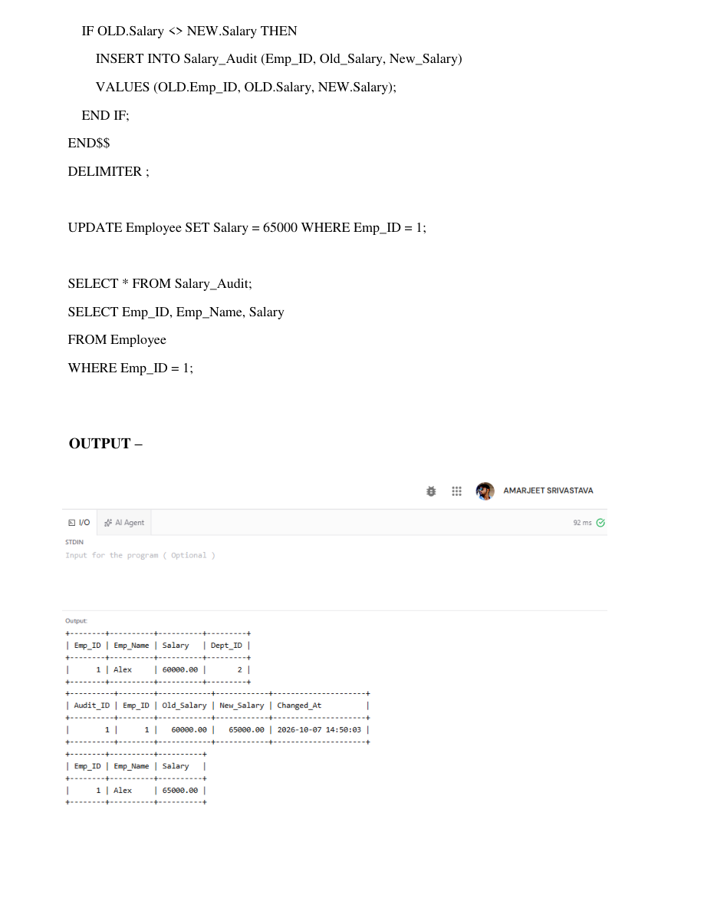

# DBMS Experiment 6

## Aim

To create a stored procedure transfer_employee(emp_id, new_dept_id) with validation and 
error handling, and to implement triggers for salary validation and audit logging, including 
testing of edge cases.

## Source Code

```sql
CREATE TABLE Department (
    Dept_ID INT PRIMARY KEY,
    Dept_Name VARCHAR(100) NOT NULL
);

CREATE TABLE Employee (
    Emp_ID INT PRIMARY KEY,
    Emp_Name VARCHAR(100) NOT NULL,
    Salary DECIMAL(10,2) NOT NULL,
    Dept_ID INT,
    FOREIGN KEY (Dept_ID) REFERENCES Department(Dept_ID)
);

INSERT INTO Department (Dept_ID, Dept_Name)
VALUES (1, 'Sales'), (2, 'Engineering');

INSERT INTO Employee (Emp_ID, Emp_Name, Salary, Dept_ID)
VALUES (1, 'Alex', 60000.00, 1);

CREATE TABLE Salary_Audit (
    Audit_ID INT AUTO_INCREMENT PRIMARY KEY,
    Emp_ID INT,
    Old_Salary DECIMAL(10,2),
    New_Salary DECIMAL(10,2),
    Changed_At TIMESTAMP DEFAULT CURRENT_TIMESTAMP

);

DELIMITER $$
CREATE PROCEDURE transfer_employee(
    IN p_emp_id INT,
    IN p_new_dept_id INT
)
BEGIN
    DECLARE emp_count INT DEFAULT 0;
    DECLARE dept_count INT DEFAULT 0;

    SELECT COUNT(*) INTO emp_count
    FROM Employee
    WHERE Emp_ID = p_emp_id;

    SELECT COUNT(*) INTO dept_count
    FROM Department
    WHERE Dept_ID = p_new_dept_id;

    IF emp_count = 0 THEN
        SIGNAL SQLSTATE '45000'
            SET MESSAGE_TEXT = 'Employee does not exist';
    ELSEIF dept_count = 0 THEN
        SIGNAL SQLSTATE '45000'
            SET MESSAGE_TEXT = 'Department does not exist';
    ELSE
        UPDATE Employee
        SET Dept_ID = p_new_dept_id
        WHERE Emp_ID = p_emp_id;
    END IF;

END$$
DELIMITER ;

CALL transfer_employee(1, 2);
SELECT * FROM Employee WHERE Emp_ID = 1;

-- Uncomment and test these calls individually; each intentionally raises an error.
-- CALL transfer_employee(666, 2); --
CALL transfer_employee(1, 666);

DELIMITER $$
CREATE TRIGGER before_employee_salary_update
BEFORE UPDATE ON Employee
FOR EACH ROW
BEGIN
    IF NEW.Salary < 0 THEN
        SIGNAL SQLSTATE '45000'
            SET MESSAGE_TEXT = 'Salary cannot be negative';
    END IF;
END$$
DELIMITER ;

-- This update intentionally raises an error; uncomment to test the validation trigger.
-- UPDATE Employee SET Salary = -5000 WHERE Emp_ID = 1;

DELIMITER $$
CREATE TRIGGER after_employee_salary_update
AFTER UPDATE ON Employee
FOR EACH ROW
BEGIN

    IF OLD.Salary <> NEW.Salary THEN
        INSERT INTO Salary_Audit (Emp_ID, Old_Salary, New_Salary)
        VALUES (OLD.Emp_ID, OLD.Salary, NEW.Salary);
    END IF;
END$$
DELIMITER ;

UPDATE Employee SET Salary = 65000 WHERE Emp_ID = 1;

SELECT * FROM Salary_Audit;
SELECT Emp_ID, Emp_Name, Salary
FROM Employee
WHERE Emp_ID = 1;
```

## Output Screenshots

### Output 1


